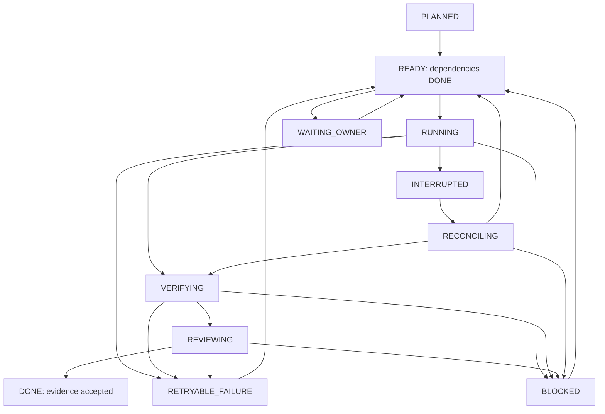

# ADR-002 — непрерывное выполнение принятого SDLC-плана

**Статус:** **режим A Accepted for staged implementation** по результатам PR #69; **режим B Proposed/deferred** и не разрешён к реализации. **Назначение:** обеспечить непрерывный переход между задачами; восстановление после остановки — отдельный контракт.
**Граница:** это описание целевой реализации, не утверждение, что такой контроллер уже есть в NAPMS или OpenCode.

## 1. Проблема и ключевое решение

В NAPMS уже есть принятые спецификации OpenSpec, GitHub PR, Codex-роли и проверки. Однако **сессия LLM не является надёжным диспетчером долговременного плана**: контекст может сжаться, модель/квота закончиться, CLI/процесс — завершиться, а записи в Git и тесты могли успеть выполниться.

**Решение для режима с гарантированным восстановлением (B):** разделить:
1. **Plan** — версионированная, утверждаемая человеком декларация задач и зависимостей.
2. **Controller** — небольшой **детерминированный** локальный исполнитель DAG и конечного автомата (без LLM и без свободного изменения плана).
3. **OpenCode runtime** — интерактивная/программная среда, где Orchestrator/Explorer/Architect/Planner/Worker/Reviewer решают ограниченные задачи.
4. **Evidence** — реальное состояние git, OpenSpec, тестов, review и PR; отдельная запись runtime-state нужна только для прогресса, а не для истинности результата.
5. **Owner gate** — явное событие принятия архитектуры, изменения бюджета, запуска опасной операции, product acceptance или merge.

**В режиме A один запуск и последовательный переход обеспечивает сам локальный Orchestrator в активной OpenCode-сессии**; состояние работы закрепляется в Git/OpenSpec и task handoff. **В режиме B Controller** отвечает за надёжное продолжение после завершения процесса и предотвращение повторных опасных операций. Orchestrator координирует scoped work item, а не меняет утверждённый план.

**OpenCode из коробки** предоставляет вызовы `opencode run`, `--continue`, `--session`, вывод JSON, sessions, API/SDK и субагентов; **не подтверждено**, что он самостоятельно реализует бизнес-планирование DAG, журнал принятия и восстановление всех побочных эффектов после restart. Это ответственность выбранного контроллера.

Источники: [CLI commands](https://opencode.ai/docs/cli/commands), [agents](https://opencode.ai/docs/agents), [tools/subagent](https://opencode.ai/docs/tools), [SDK](https://opencode.ai/docs/build/sdk), [server sessions](https://opencode.ai/docs/build/plugins/server), [compaction](https://opencode.ai/docs/compaction).

## 2. Конкурирующие варианты исполнения

| Подход | Что обеспечивает | Недостаток | Решение |
| --- | --- | --- | --- |
| **A. Одна активная OpenCode-сессия** | Orchestrator выполняет разрешённые задачи последовательно, используя Git/OpenSpec и результаты проверок; можно возобновить сессию по ID | Нет гарантии exactly-once после сбоя и полноценного unattended DAG recovery | **Начальный режим: сначала проверить end-to-end** |
| **B. Малый локальный Controller + OpenCode** | Durable DAG, checkpoints, owner approvals, restart/reconcile, контроль повторных side effects | Требуется собственный код, state и тестирование crash consistency | **Условное расширение, если требуется гарантированное восстановление** |
| **C. LangGraph/CrewAI/AutoGen runtime вместо Controller** | Готовые паттерны stateful orchestration | Новая зависимость, агентный state-layer и интеграция git/OpenSpec всё равно нужны | Не вводить без доказанной необходимости |

**KISS:** режим A запускается без нового контроллера. Если требуется режим B, контроллер не принимает архитектурные решения, не занимается RAG и не реализует самописную память; запускает задачи принятого DAG и проверяет только объективные события. План может составить Planner, но **верхнеуровневые work packages, ограничения и approval gates принимает владелец**. Внутри пакета Planner вправе уточнять bounded tasks без расширения scope, прав и бюджета.

## 3. Два независимых уровня плана

### Верхний уровень: SDLC work packages

- Хранится в версионированном Git-файле проекта (например, `docs/engineering/plans/<plan-id>.yaml`, путь утвердить при внедрении).
- Содержит стабильные task IDs, зависимости, ограничения, роли, модельный tier, бюджеты, expected evidence, owner gates.
- После утверждения immutable по смыслу: изменение целей/разрешений/лимитов формирует новую ревизию файла и одобрение; контроллер связывает run с digest/revision.

### Нижний уровень: OpenSpec

- Для продуктового среза Planner оформляет proposal/design/specs/tasks **по существующим OpenSpec Skills**.
- Статусы чекбоксов OpenSpec не заменяют состояние выполнения Work Package и наоборот.
- Реальный GitHub Issue/PR — внешний контракт приемки, ревью и согласования, а не внутренний таймер работы.
- Не дублировать один и тот же статус в трёх независимых «источниках истины»: **план описывает намерение; журнал контроллера — запуск; Git/CI — доказанный результат**.

### Пример контракта задачи (схема *предлагается*, пока нет парсера)

```yaml
plan_id: napms-local-agents
revision: 1
base: main
concurrency: 1             # write tasks; read-only scouting may be parallel
tasks:
  - id: env-check
    depends_on: []
    role: explorer
    model_tier: economy
    allowed_paths: []
    acceptance:
      - "CLI versions + available providers recorded"
  - id: capability
    depends_on: [env-check]
    role: orchestrator
    model_tier: standard
    allowed_paths: ["disposable-worktree/**"]
    acceptance:
      - "actual model, skills and permission smoke recorded"
  - id: owner-runtime-decision
    depends_on: [capability]
    kind: approval
    gate: architecture
    acceptance:
      - "explicit owner approval of runtime choice"
  - id: configure-roles
    depends_on: [owner-runtime-decision]
    role: worker
    model_tier: standard
    allowed_paths: [".opencode/**", "AGENTS.md"]
    acceptance:
      - "role isolation test and minimal workflow pass"
```

**Инварианты DAG:** уникальные IDs, отсутствие циклов и несуществующих зависимостей; выполненная задача не переисполняется без invalidation; все работы в записи имеют одного владельца; `approval` не может пройти автоматически. Разрешённые пути — whitelist для задачи, техническая изоляция применена отдельно.

## 4. Автомат состояний (только режим B)



- `PLANNED`: ещё не разрешено.
- `READY`: все входные зависимости имеют `DONE`, approval/eventual budget допустимы.
- `RUNNING`: получена блокировка, зафиксированы `run_id`, `task_id`, `attempt`, `plan_digest`, base/head.
- `VERIFYING`: сверка файлов, exit status проверок, SHA и bounded acceptance criteria.
- `REVIEWING`: независимый ревьюер изучает diff, P0/P1 блокируют.
- `DONE`: только после фактических проверок и подтверждённых критериев; текст LLM «готово» не считается доказательством.
- `RETRYABLE_FAILURE`: временный отказ сети/модели при отсутствии неоднозначного побочного эффекта, с ограничением повторов.
- `BLOCKED`: нарушение контракта, нехватка разрешений, P0/P1 после лимита исправлений, недоступный safe model tier, ошибка конфигурации.
- `WAITING_OWNER`: неустранимое машиной решение владельца; контроллер останавливает продвижение зависимых задач.
- `INTERRUPTED`: потеря процесса/сессии; при `RECONCILING` сначала изучаются реальные Git/PR/логи, затем принимается решение продолжать/повторять/блокировать.

Неиспользуемые терминальные статусы `CANCELLED` и `SUPERSEDED` допустимы только по явной команде владельца.

## 5. Контроллер режима B: конечный цикл без автономного изменения требований

```text
load plan + signature/digest + last checkpoint
acquire single-writer lock (per worktree/plan)
validate DAG and permissions
reconcile any interrupted attempt with Git/PR/evidence
loop:
    ready = tasks with all deps DONE and no owner/budget gate
    if none: finish if all DONE; else report WAITING_OWNER/BLOCKED
    select one allowed work item (deterministic stable order)
    persist RUNNING and correlation ID *before* external action
    invoke role through selected runtime adapter with bounded contract
    collect actual tool/command results; persist trace pointer
    verify acceptance / request independent review
    persist DONE only for verified result; otherwise retry/stop
release lock
```

- **Исполнитель вызывает OpenCode** через поддерживаемый `opencode run` или SDK/API после локального smoke. Конкретный adapter выбирается по фактическим CLI и секретам. Вызов самого `opencode` из текущего ChatGPT-чата не осуществляется.
- **Нет бесконечных циклов**: максимум 2 повторных scoped исправления после review; временные ошибки до 2 повторов, затем BLOCKED. Значения конфигурируемы в локальном плане, не обходят P0.
- **Никаких скрытых незапланированных операций:** изменённый набор файлов, новые зависимости, оплачиваемый API, GitHub push, merge, destructive migrations требуют утверждённого gate. Read-only задачи могут параллелиться по явной политике, по умолчанию одна write-task.
- **Отдельный runtime adapter** не должен обещать поддержку всех инструментов Codex/OpenCode без проверки. GitHub merge вообще не является adapter action по умолчанию.

## 6. Durable state и восстановление (режим B)

### Что хранить

| Данные | Где | Источник авторитета |
| --- | --- | --- |
| Утверждённый план/его ревизия | Версионированный Git, отдельный план/PR | Владелец утверждает в Git |
| История task attempts, статусы, lease, session IDs, model tiers | Локальный state-файл за пределами публичного репозитория, например `$XDG_STATE_HOME/napms-agent/<repo>/<run-id>.json` | Только операционный прогресс |
| Действительные файлы, commits и diff | Worktree и Git | Git |
| Тесты/CI/evidence | Локальные логи с exit code, GitHub Actions/PR | Проверенные команды и связанный SHA |
| Owner approvals | Явное подтверждение **авторизованного владельца**, привязанное к plan digest + gate ID + предмету решения; GitHub comment допустим только после проверки identity/permissions | Человек, не LLM; произвольный текст Issue/PR не считается approval |

**Первая реализация:** один локальный controller process + advisory lock + JSON-запись атомарным temp-write/fsync/rename (проверять права), без SQLite/очереди/демона; на локальных дисках WSL. При параллельных writers/многопроцессности потребуется отдельное решение о lock/transactional store.

State хранит **ссылки** на лог/сессию, но не промпт-транскрипты, bearer tokens, PII или секреты. State-directory исключён из коммитов и доступен только пользователю. `session_id` — помощь для продолжения контекста, но **не гарантия idempotency**.

### Протокол restart

1. Захватить lock и перечитать план, убедиться, что digest совпадает. Изменившийся план → `BLOCKED: plan_revision_mismatch`.
2. Для `RUNNING/INTERRUPTED`: сверить рабочий каталог, `git status`, HEAD, наличие созданной ветки/PR, artifacts и тестовых результатов. Нельзя автоматически заключать о commit/merge из текстового отчёта.
3. Для side effects использовать **stable idempotency key** `<plan-digest>/<task-id>/<operation-id>`: идентификатор **не меняется между попытками**, номер `attempt` фиксируется отдельно. GitHub PR искать по `(head repository, head branch, base branch)` перед созданием; сверять SHA и тело. Никаких автоматических повторов destructive/merge. Ключ сам по себе не обеспечивает exactly-once без reconcile.
4. Если изменения уже внесены, перевести в `VERIFYING` или `BLOCKED`, а не повторять Worker поверх результата.
5. Если побочных эффектов нет и операция безопасна — пересоздать scoped LLM-сессию из Git/плана и перезапустить только задачу.
6. Завершить только после повторной проверки acceptance на **текущем SHA**; пройденные старые тесты без соответствующего кода не переиспользуются.

**Exactly-once** для Git/моделей/CI не обещается. Контроллер использует at-least-once вызовы с reconcile/idempotency/approval перед побочными действиями.

## 7. Детерминированная маршрутизация и бюджет

- Каждая задача указывает `model_tier` и `max_attempts`; реальные `provider/model` выбираются из **проверенного локального каталога** в начале task attempt.
- Рекомендуемый baseline: `critical` для архитектуры и security review, `standard` для плана/реализации, `economy` для фактов; `local` только для валидированных простых задач.
- **Soft budget** (tokens/cost/time, если метрика есть): предупредить/предложить более экономный tier **для следующей разрешённой задачи**; **hard budget**: блокировать новые вызовы, сохранить state и запросить owner action. Нет выдуманных «остатков подписки» или подмены реального billing.
- При недоступности модели: retry у *того же* tier с ограничением, затем fallback только на проверенный допустимый tier и только между задачами. Critical не понижать автоматически на непроверенную бесплатную модель.
- Параллельные модели без доказанной пользы не запускать; если несколько Explorer выполняются параллельно, общий бюджет учитывает их совокупный расход.

## 8. Owner gates и безопасность

**Всегда требуют явного владельца:** принятие ADR, изменение доменных инвариантов/API/DB migration/permissions, дополнительные траты/новый внешний провайдер, расширение allowed_paths, публикация/передача данных во внешний сервис, окончательная UX/продуктовая приёмка и merge.

**P0 останавливает весь план:** запись в `main`, неразрешённый Git push/merge, доступ к секрету, потеря sandbox изоляции, попытка обхода прав, неподтверждённый опасный side effect. **P1** останавливает конкретную задачу и зависимые до исправления, все независимые безопасные работы могут продолжаться только по заранее принятой политике.

Worker/Reviewer не имеют права публикации. **Отдельный Publisher** (детерминированная функция интеграции, не LLM-роль) может получить разрешение владельца на **push только заранее выбранной feature-ветки** и создание Draft PR; проверяет remote, branch, expected HEAD и наличие предыдущего PR. Без разрешения — только локальный diff/handoff. `main` и merge запрещены; merge — отдельная ручная операция владельца. У publisher отдельные минимальные credentials; при shell доступе агента **никакие шаблоны команд не заменяют OS sandbox**.


**P1 security enforcement:** OpenCode V2 по умолчанию разрешает многие инструменты и внешний доступ; reviewer обязан иметь явный deny `edit`, `shell` и `external_directory` либо узкий проверяемый allowlist. Разрешённый произвольный `shell` использует полномочия ОС и может изменять файлы даже при `edit: deny`. Для unattended Worker — отдельное ограниченное окружение без секретов, без доступа к `main` и удалённой публикации. Worktree сам по себе не OS sandbox. См. [OpenCode permissions](https://opencode.ai/docs/permissions).

Нельзя использовать `opencode run --auto` для обхода явных approval gates: auto-approval расширяет право исполнения команд, даже если явно deny остаётся, и не заменяет политику владельца.

## 9. Как выполняется весь план внедрения A0–A10

- Для режима B принятый DAG содержит пакеты из [adoption-plan.md](adoption-plan.md), зависимости и owner gates; режим A может обходиться без отдельного исполняемого DAG, сохраняя порядок и границы в Git/OpenSpec.
- **A0** (архитектура) — ожидает принятия ADR-001 и ADR-002.
- **A1–A2** — проверка среды/моделей/permissions, построение evidence без конфигурационного вмешательства в продукт.
- **Gate runtime** — принимает OpenCode или Codex fallback. Контроллер не может принять решение о новой подписке или передаче кода внешнему провайдеру.
- **A3–A7** — развёртывание роли/маршрутизации/проверок с проверкой после каждого bounded шага.
- **A8** — одна полная интеграционная задача в disposable ветке, на реальном, но безопасном функциональном срезе, без затрагивания PR #66/#67.
- **A9–A10** — измерение, выбор основной среды и runbook; владелец утверждает выбор.
- В режиме B после каждого `DONE` Controller переходит к следующему `READY` без нового промпта; при `WAITING_OWNER` выводит точный вопрос, варианты и evidence. В режиме A такой переход делает Orchestrator в живой сессии при тех же owner gates.

**Bootstrap:** режим A использует существующие инструменты и не нуждается в самосоздающемся контроллере. Если smoke показывает ценность режима B, Controller реализуется отдельной ограниченной задачей с E1/E3/E6/E8/E11, и только после неё может вести A4–A10. Это не «самосоздание без работающего управляющего механизма».

## 10. Приёмочные сценарии контроллера режима B

| ID | Сценарий | Ожидаемый результат |
| --- | --- | --- |
| E1 | DAG с зависимостями A→B→C | Каждая задача выполняется в порядке, нет пропущенных gates |
| E2 | Независимые read-only A/B | Могут выполняться параллельно без shared-write конфликта |
| E3 | Упасть после изменения файла, до `DONE` | После restart обнаружить diff и продолжить `VERIFYING`, без повторной записи |
| E4 | Упасть после создания Draft PR | После restart найти тот же PR, не создать дубль |
| E5 | Квота/модель недоступна | Сохранить блокировку и handoff; critical не понижать автоматически |
| E6 | Неизвестный результат команды/теста | `BLOCKED`/повторная проверка; никогда не `DONE` по тексту LLM |
| E7 | Тесты падают / Reviewer P1 | Только bounded retry; после лимита эскалация |
| E8 | Нет owner approval | `WAITING_OWNER`, зависимые задачи не выполняются |
| E9 | Изменился SHA `main`/план | Требуется reconcile/rebase и актуальные проверки; старый CI не считается валидным |
| E10 | Попытка записи вне worktree / git push / merge | Запрет, P0 и остановка |
| E11 | Повтор запуска завершённого плана | Без повторного запуска side effects |
| E12 | Смена модели между задачами | Контракт и данные сохраняются, фактическая модель записана если доступна |

## 11. Граница достаточности

Минимальный ценный результат — **один конечный plan run**, три связанные задачи, restart после изменения файла, один owner gate и один независимый review, без дублирования Git/PR. Не разрабатывать UI диспетчера, scheduler, распределённую очередь, собственную memory/RAG, LangGraph-кластер или полный SDK adapter до подтверждённой потребности.

**Решение после merge пилота #69:** режим A принят для первого постоянного Harness; пять последовательных ролей и gate Validator продемонстрированы на одном ограниченном артефакте. Режим B остаётся условным, Controller не реализован и не разрешён к внедрению до отдельного решения владельца. [Реестр решений](decision-2026-11-14.md).
